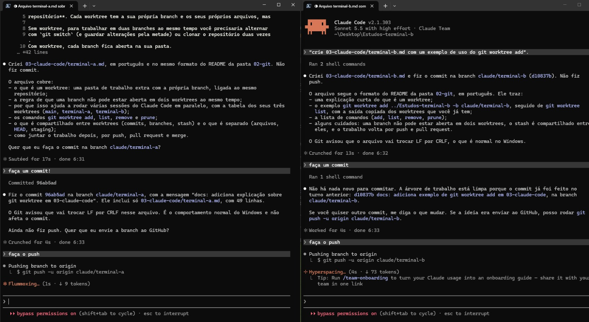

# 03 - Claude Code com vários terminais ao mesmo tempo

## O que é um worktree
Um `git worktree` é uma **pasta de trabalho extra ligada ao mesmo repositório**. Cada
worktree tem a sua própria branch e os seus próprios arquivos, mas todos compartilham o
mesmo histórico (a pasta `.git`). Nada é clonado de novo.

Sem worktree, para mexer em duas branches ao mesmo tempo é preciso alternar com
`git switch` (e guardar o trabalho pela metade) ou clonar o repositório duas vezes. Com
worktree, cada branch fica aberta na sua pasta.

## Por que isso serve para o Claude Code
Dá para abrir um Claude Code em cada terminal, cada um numa pasta e numa branch. Como as
pastas são separadas, uma sessão não sobrescreve os arquivos da outra e cada uma faz o
seu commit sem esbarrar na outra. No fim, cada branch vira um pull request.

## O que foi feito neste estudo
Três pastas ligadas ao mesmo repositório:

| Pasta | Branch | Para que serviu |
|-------|--------|-----------------|
| `Estudos` | `main` | pasta principal |
| `Estudos-terminal-a` | `claude/terminal-a` | terminal A: explicação do que é worktree |
| `Estudos-terminal-b` | `claude/terminal-b` | terminal B: exemplo de uso do `git worktree add` |

Os dois terminais foram criados assim, a partir da `main`:

```bash
git worktree add ../Estudos-terminal-a -b claude/terminal-a
git worktree add ../Estudos-terminal-b -b claude/terminal-b
```

Depois, um `claude` em cada pasta. Cada terminal criou **um arquivo diferente** em
`03-n8n-com-um-chatbot/` (`terminal-a.md` e `terminal-b.md`), fez o commit na sua branch e
enviou com `git push`. Cada branch virou um pull request, e os dois foram mergeados.

## Print dos terminais
Os dois terminais do Claude Code abertos ao mesmo tempo: um em `Estudos-terminal-a`
(branch `claude/terminal-a`) e o outro em `Estudos-terminal-b` (branch `claude/terminal-b`).



## Comandos
```bash
git worktree add ../pasta -b nova-branch   # cria a pasta e uma branch nova
git worktree add ../pasta branch-existente # cria a pasta para uma branch que já existe
git worktree list                          # lista os worktrees e a branch de cada um
git worktree remove ../pasta               # apaga a pasta (a branch continua existindo)
git worktree prune                         # limpa registros de pastas apagadas na mão
```

## Quando vale a pena
- Duas tarefas **independentes** no mesmo projeto, como uma feature nova e uma correção.
- Cada tarefa mexe em **arquivos ou pastas diferentes**.
- Uma tarefa longa (um refactor, por exemplo) está rodando e você precisa fazer outra coisa
  sem interromper nem trocar de branch.
- Rodar testes ou um build numa branch enquanto continua editando em outra.

## Quando atrapalha
- As duas tarefas mexem nos **mesmos arquivos**. O paralelismo só adianta o trabalho; no
  merge vem um conflito, e resolver conflito custa mais do que ter feito uma tarefa por vez.
- Uma tarefa depende do resultado da outra. Aí tem que esperar de qualquer forma.
- O projeto precisa de setup por pasta (`npm install`, `.env`, banco local). Cada worktree
  novo é uma pasta sem nada disso, e as portas podem colidir se os dois rodam servidores.
- Muitos terminais abertos ao mesmo tempo: fica difícil acompanhar e revisar o que cada um
  fez, e isso pesa mais do que o tempo economizado.

## Como não mexer no mesmo arquivo
1. **Divida o trabalho por arquivo ou pasta antes de começar** e diga isso a cada Claude
   Code no primeiro prompt ("mexa só em `03-n8n-com-um-chatbot/terminal-a.md`"). Neste estudo,
   cada terminal ficou com um arquivo.
2. Se dois terminais precisam do mesmo arquivo, faça um terminal de cada vez ou separe o
   arquivo em dois.
3. **Branch curta e merge cedo.** Quanto mais tempo uma branch fica sem ser mergeada, maior
   a chance de conflito. Depois de mergear uma, atualize a outra com `git merge main`.
4. Mergear um PR de cada vez e conferir se o outro PR continua sem conflito.
5. Se mesmo assim der conflito, é o mesmo caso do `02-git/README.md`: trazer a `main` para
   a branch, resolver à mão, `git add`, `git commit` e `git push`.

## Cuidados do próprio worktree
- Uma mesma branch **não pode** estar aberta em dois worktrees ao mesmo tempo. O Git recusa.
- O `git stash` é **compartilhado** entre todos os worktrees. Um `git stash pop` numa pasta
  pode puxar alterações guardadas em outra. Prefira um commit temporário.
- Commits, branches e tags são compartilhados; os arquivos, o `HEAD` e a área de staging
  (`git add`) são separados em cada pasta.
- Ao terminar, remova as pastas com `git worktree remove` em vez de apagá-las na mão.
