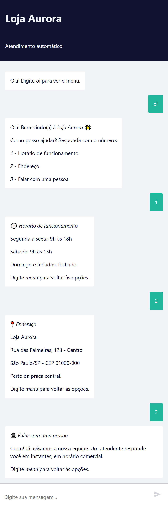
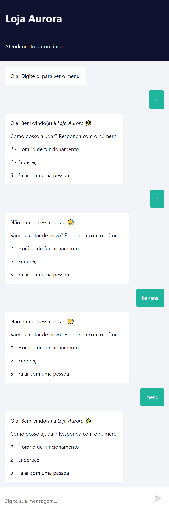
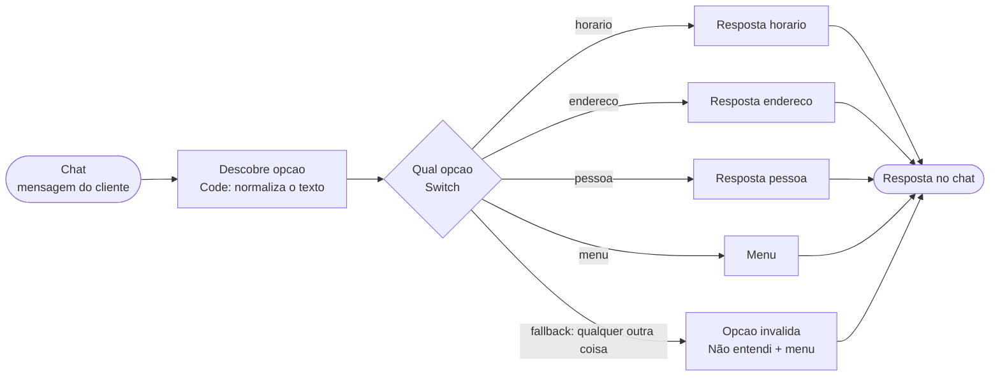

# 04 - n8n com chatbot de menu

Chatbot da **Loja Aurora** (loja inventada) feito no n8n, que responde por menu. Sobe
com Docker Compose no PC e é testado no **chat do próprio n8n**.
**Sem IA**: as respostas são fixas, escolhidas por regra.

## O menu

```
Olá! Bem-vindo(a) à Loja Aurora 🌟
1 - Horário de funcionamento
2 - Endereço
3 - Falar com uma pessoa
```

| O cliente digita | O bot responde |
|------------------|----------------|
| `1` ou `horario` | horário de funcionamento |
| `2` ou `endereco` | endereço da loja |
| `3`, `pessoa` ou `atendente` | avisa que um atendente vai responder |
| `menu`, `oi`, `ola`, `bom dia`... | mostra o menu |
| **qualquer outra coisa** | "Não entendi essa opção" e **mostra o menu de novo** |

O texto é normalizado antes de comparar (minúsculas, sem acento, sem espaços nas pontas),
então `Horário`, `HORARIO` e ` 1 ` funcionam.

## Como rodar

Precisa do Docker Desktop aberto.

```bash
cd 04-n8n-whatsapp-menu
docker compose up -d
```

1. Abra http://localhost:5678 e crie a conta local do n8n (só na primeira vez).
2. Menu `...` > **Import from file** > `workflow-menu-loja.json`.
3. Clique em **Open chat** no workflow e teste, ou ative o workflow (**Active**) e use o
   link do nó **Chat** (`http://localhost:5678/webhook/5a7f9c2e-3b1d-4e6a-9f10-0a0a0a000001/chat`).

Para parar: `docker compose down` (os workflows ficam salvos no volume `n8n_data`).
`docker compose down -v` apaga também os dados.

## Conversa de teste (prints)

Prints tirados do chat do n8n com o workflow ativo.

**Escolhendo as opções 1, 2 e 3**



**Opção errada (`7` e `banana`) volta ao menu**



## Como foi testado

- **Workflow:** importado e ativado no n8n 2.44.4 e testado no chat do n8n e chamando o
  endereço do chat (`.../webhook/<id>/chat`). Passaram `oi`, `1`, `2`, `3`, `Horário`,
  ` 2 `, `ENDEREÇO`, `atendente`, `menu`, e `7` e `banana` voltaram ao menu.
- Outro ajuste achado nos prints: o chat do n8n lê as respostas como markdown, e uma única
  quebra de linha some. Por isso cada linha das respostas é separada por uma linha em
  branco; assim o menu aparece uma opção por linha.
- Um bug achado no teste: o regex que tira acentos estava salvo no JSON com os caracteres
  combinantes crus, e `Horário` não era reconhecido dentro do n8n. Corrigido usando o
  escape `̀-ͯ` no código.

## Como o workflow funciona



1. **Chat** (Chat Trigger): recebe a mensagem em `chatInput`.
2. **Descobre opcao** (Code): normaliza o texto e devolve `horario`, `endereco`, `pessoa`,
   `menu` ou `invalida`.
3. **Qual opcao** (Switch): uma saída por opção. A saída de **fallback** (tudo que não
   bateu) vai para o nó **Opcao invalida**, que responde e reapresenta o menu. É isso que
   faz a opção errada "voltar ao menu".
4. Cada **Set** guarda a resposta no campo `output`, que o Chat Trigger devolve ao cliente.

O bot não guarda estado: cada mensagem é avaliada sozinha. Por isso "voltar ao menu" é só
responder o menu de novo.

## E o WhatsApp?

Para trocar o chat do n8n pelo WhatsApp, só muda a **entrada e a saída**; o miolo
(Code + Switch + Set) é o mesmo:

- Entrada: nó **WhatsApp Trigger** no lugar do **Chat**, e o texto vem em
  `messages[0].text.body`.
- Saída: nó **WhatsApp** (Send message) no final de cada resposta.
- Exige conta na Meta (WhatsApp Cloud API, que dá um número de teste) e uma **URL pública**
  para o webhook (ngrok ou cloudflared), porque a Meta não enxerga o `localhost`.

Isso não foi montado neste estudo; o teste foi feito pelo chat do n8n.

## Arquivos

| Arquivo | O que é |
|---------|---------|
| `docker-compose.yml` | sobe o n8n na porta 5678, com volume para guardar os dados |
| `workflow-menu-loja.json` | o workflow, para importar no n8n |
| `prints/` | prints da conversa no chat do n8n |
