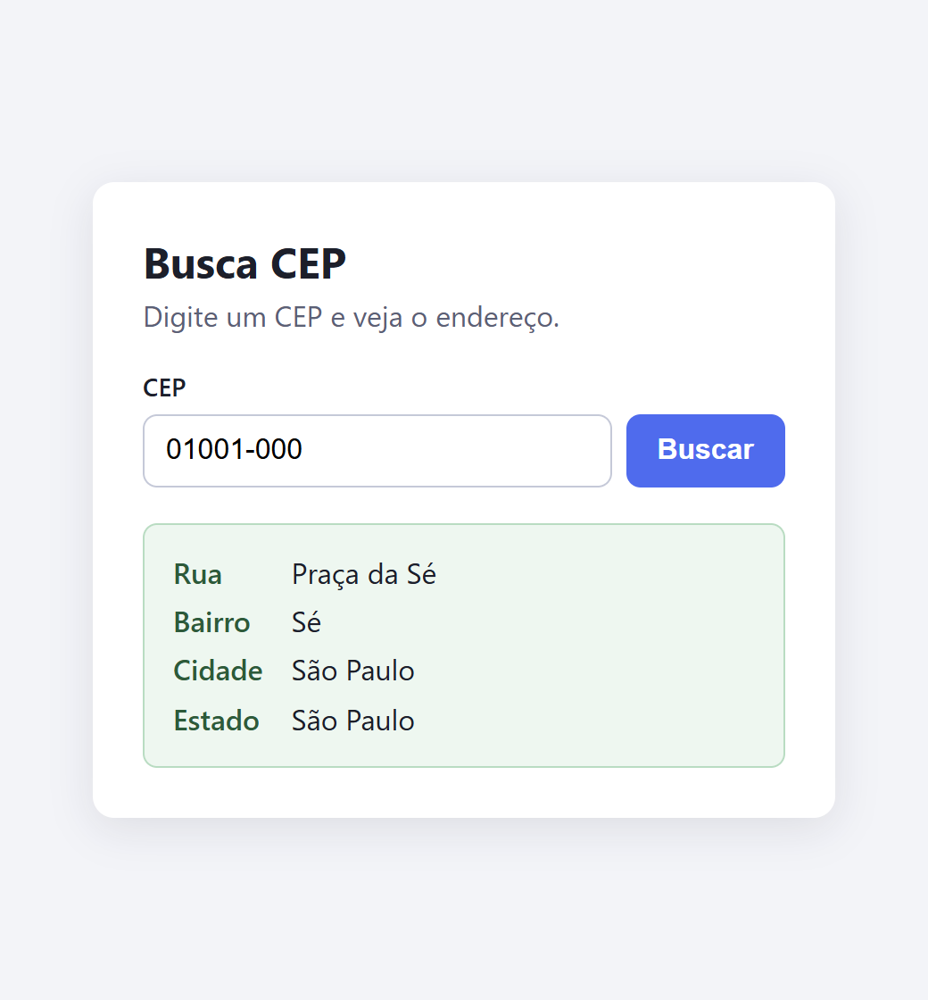
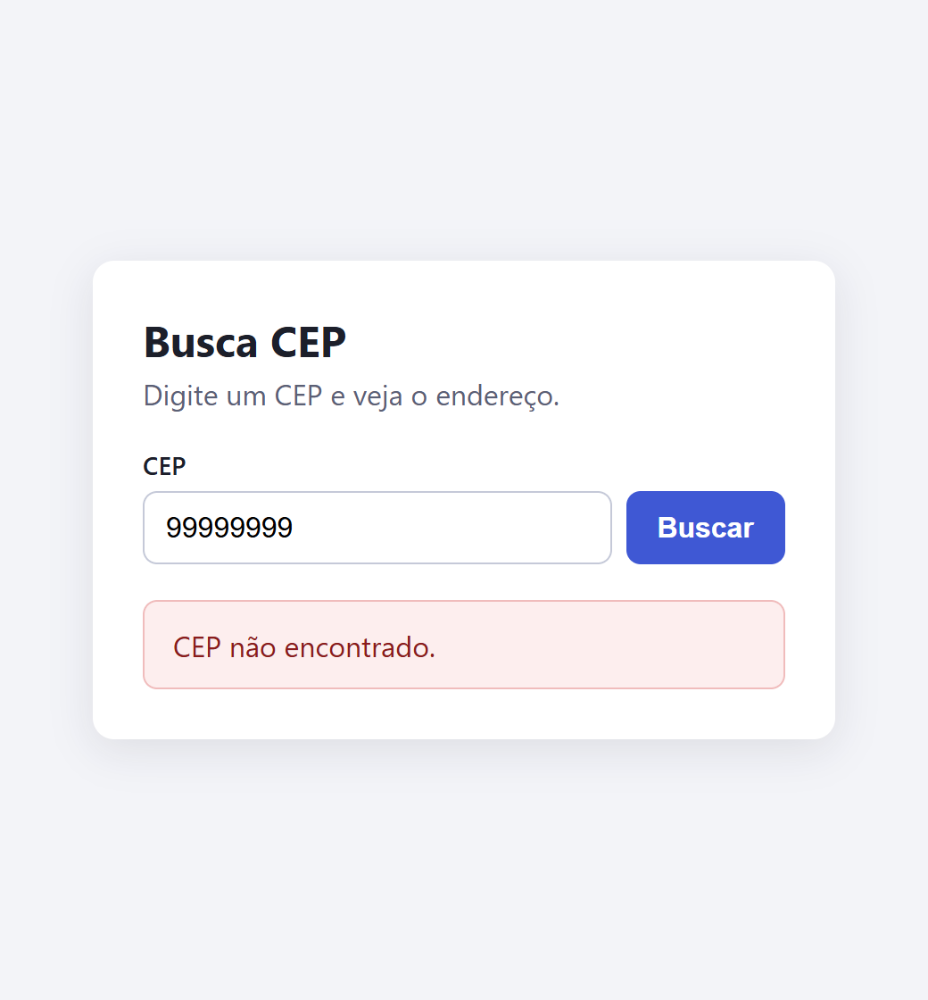
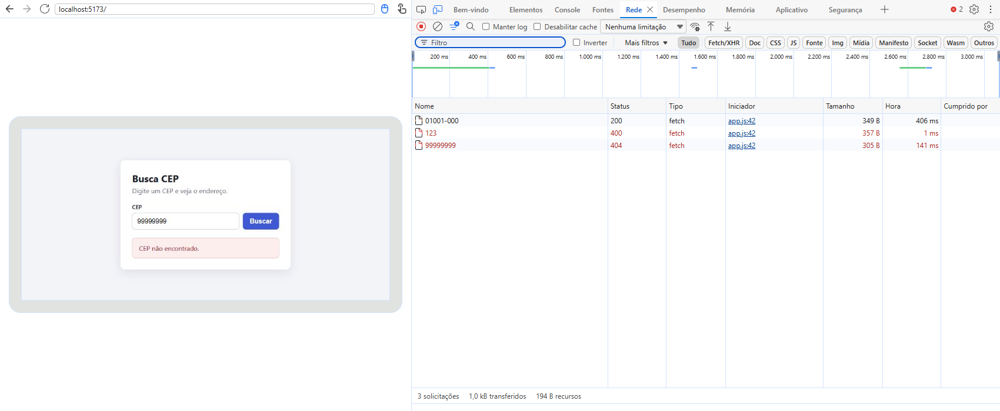
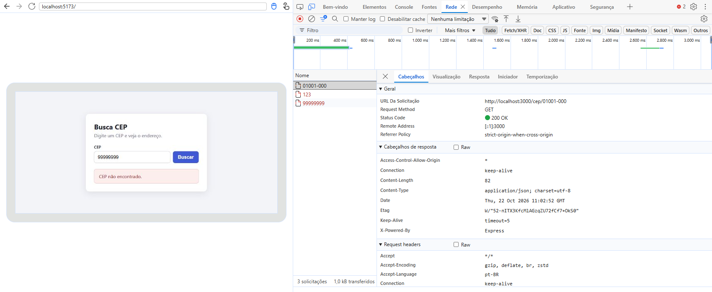

# 05 - Busca CEP: front-end e back-end

App pequeno com as duas partes: uma **página** onde a pessoa digita um CEP e um **back-end**
que busca o endereço na API pública do [ViaCEP](https://viacep.com.br) e devolve só rua,
bairro, cidade e estado. A página nunca fala com o ViaCEP: ela só fala com o meu back-end.

Vídeos que serviram de base: [Front-end, Back-end e Full stack](https://youtu.be/iSqf2iPqJNM)
(Curso em Vídeo) e [Como o FRONTEND e o BACKEND conversam?](https://youtu.be/TnKk01mEqZM)
(JovemScript).

| Endereço encontrado | CEP que não existe |
|---------------------|--------------------|
|  |  |

## Como rodar

Precisa do Node 20 ou mais novo. São dois programas, então são dois terminais, os dois
dentro da pasta `05-busca-cep`:

```bash
# terminal 1: o back-end (porta 3000)
cd backend
npm install
npm start
```

```bash
# terminal 2: o front-end (porta 5173)
cd frontend
npm start
```

Abra http://localhost:5173, digite um CEP (por exemplo `01001-000`) e clique em **Buscar**.
Se o back-end estiver desligado, a página avisa.

Para ver o back-end sozinho, sem a página:

```bash
curl http://localhost:3000/cep/01001000
```

Os testes do back-end rodam com `npm test`, dentro de `backend`.

## O que é o front e o que é o back neste app

| | Pasta | O que faz | Onde roda |
|---|---|---|---|
| **Front-end** | `frontend/` | É o que a pessoa vê e usa: o campo, o botão e o endereço (ou o erro) na tela. Feito com HTML, CSS e JavaScript. | No **navegador** de quem abre a página |
| **Back-end** | `backend/` | É a parte invisível: recebe o pedido, valida o CEP, consulta o ViaCEP e decide a resposta. Feito com Node e Express. | No **servidor** (aqui, no meu PC, porta 3000) |

O `frontend/server.js` só entrega os três arquivos da página para o navegador. Quem busca o
CEP é o back-end. Por isso o front e o back rodam em portas diferentes (5173 e 3000) e o
back-end precisa avisar o navegador que aceita ser chamado pela página (isso se chama CORS;
no código é o cabeçalho `Access-Control-Allow-Origin`).

## O caminho de uma busca, do clique até a resposta

1. A pessoa digita `01001-000` e clica em **Buscar**.
2. O `frontend/app.js` pega o texto do campo e faz uma requisição
   `GET http://localhost:3000/cep/01001-000` para o **meu back-end**.
3. O back-end (`backend/src/app.js`) recebe o pedido na rota `GET /cep/:cep` e confere o
   CEP. Se não tiver 8 números, já responde **400** e para aqui.
4. Se o CEP for válido, o back-end (`backend/src/viacep.js`) faz a sua própria requisição
   `GET https://viacep.com.br/ws/01001000/json/`. Aqui o back-end age como cliente do ViaCEP.
5. O ViaCEP responde com muitos campos. O back-end guarda só `rua`, `bairro`, `cidade` e
   `estado` e responde **200** com esse JSON. Se o ViaCEP disser que o CEP não existe,
   responde **404**.
6. O `app.js` recebe a resposta, lê o JSON e mostra o endereço na tela. Se veio erro (400 ou
   404), mostra a mensagem que o back-end mandou.

```
navegador (front)  --GET /cep/01001-000-->  back-end  --GET /ws/01001000/json-->  ViaCEP
navegador (front)  <--200 + JSON-----------  back-end  <--dados completos---------  ViaCEP
```

### Print da aba Rede (Network) do navegador

Três buscas seguidas: `01001-000`, `123` e `99999999`. Cada uma aparece como uma chamada
`fetch` para o back-end, com o seu status (200, 400 e 404):



Clicando na primeira chamada, aparecem os detalhes: o endereço chamado é o do **meu
back-end** (`http://localhost:3000/cep/01001-000`), o método é `GET` e o status é `200 OK`.
Nos cabeçalhos da resposta está o `Access-Control-Allow-Origin` do CORS.



## GET, POST, rota e status

- **GET**: o jeito de **pedir** algo ao servidor, sem alterar nada. Os dados vão na própria
  URL. O Busca CEP só usa GET: "me dá o endereço deste CEP".
- **POST**: o jeito de **enviar** dados para o servidor guardar ou processar, com os dados
  indo num corpo (geralmente JSON). Serve, por exemplo, para fazer login ou criar uma tarefa.
  O Busca CEP não usa POST, porque só consulta.
- **Rota** (ou endpoint): o endereço que o back-end atende, junto com o método. Aqui só há
  uma: `GET /cep/:cep`. O `:cep` é a parte que muda a cada busca (em `/cep/01001-000`, o
  `:cep` vale `01001-000`).
- **Status**: o número que o back-end devolve para dizer como foi o pedido.

| Status | Significa | Quando acontece no Busca CEP |
|--------|-----------|------------------------------|
| **200** OK | Deu certo | CEP válido e encontrado: volta `{"rua", "bairro", "cidade", "estado"}` |
| **400** Bad Request | O pedido veio errado | CEP fora do formato (`123`, `abcdefgh`): "CEP inválido. Informe 8 números, com ou sem hífen" |
| **404** Not Found | Não existe | CEP bem escrito mas que o ViaCEP não conhece (`99999999`): "CEP não encontrado." Também vale para uma rota que não existe |

Além desses três, se o ViaCEP estiver fora do ar o back-end responde **502** com uma mensagem
pedindo para tentar de novo.

## Arquivos

| Arquivo | O que é |
|---------|---------|
| `backend/src/app.js` | a rota `GET /cep/:cep`, a validação e os status |
| `backend/src/viacep.js` | a chamada ao ViaCEP |
| `backend/src/server.js` | liga o back-end na porta 3000 |
| `backend/test/cep.test.js` | testes da rota (200, 400, 404, 502 e CORS) |
| `frontend/index.html`, `app.js`, `style.css` | a página |
| `frontend/server.js` | entrega a página no navegador (porta 5173) |
| `prints/` | prints da página e da aba Rede |
