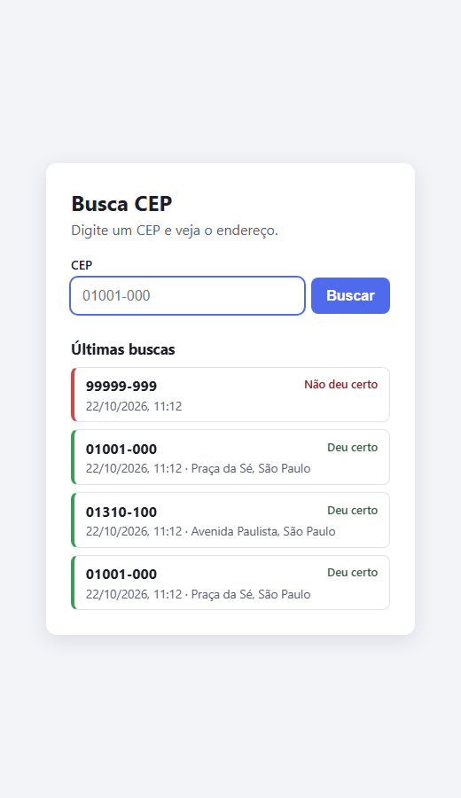
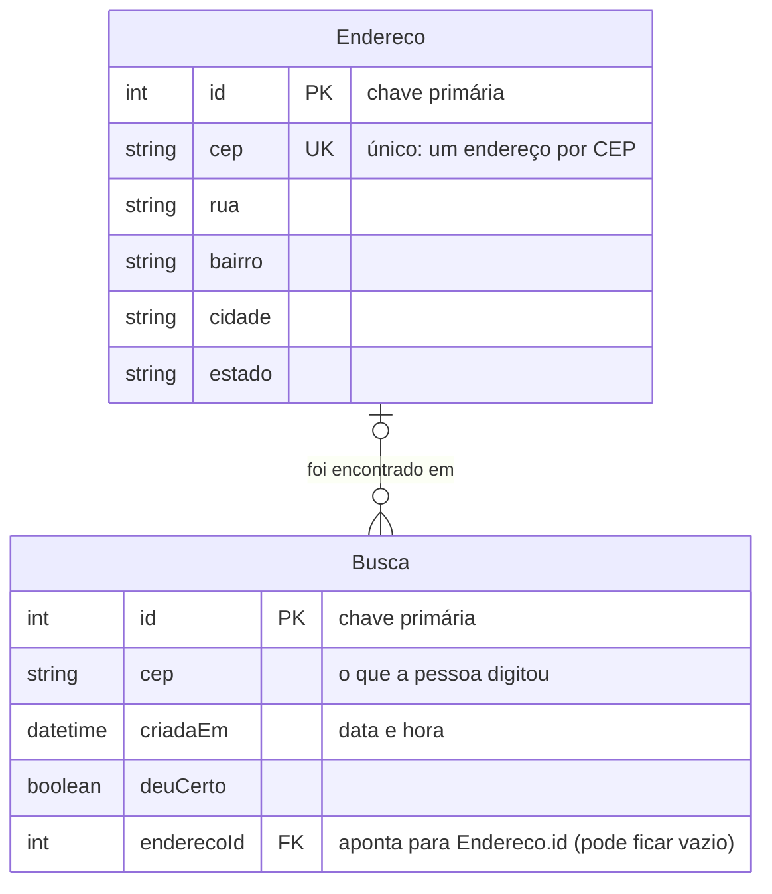
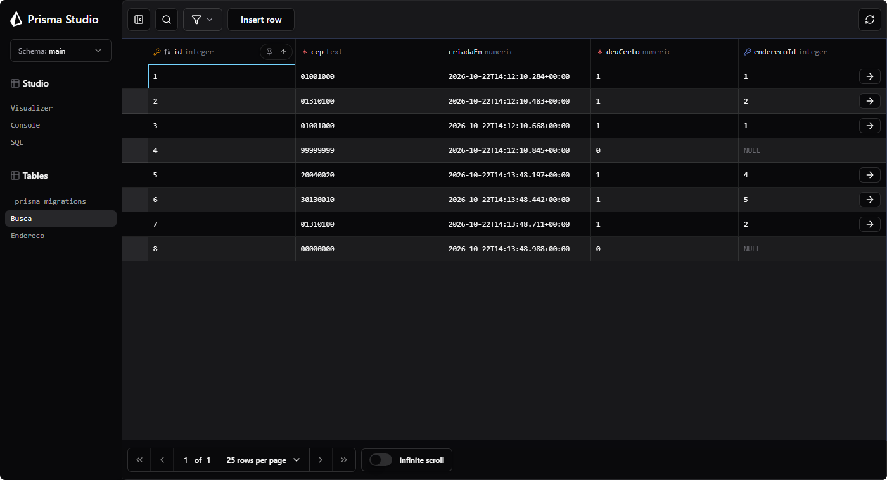
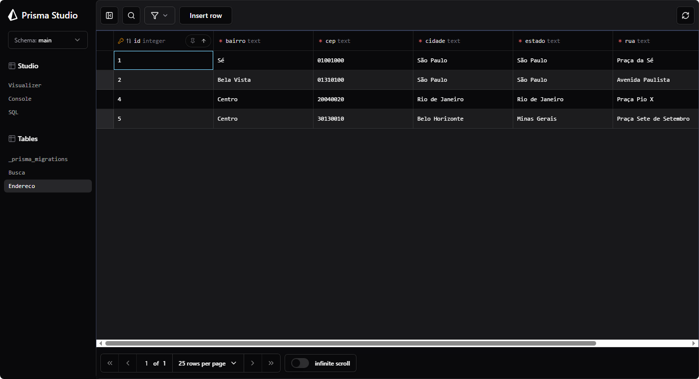
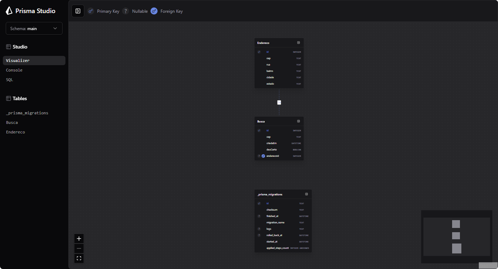

# 06 - Banco de dados: o histórico de buscas do Busca CEP

O Busca CEP do estudo 05 esquecia tudo assim que a resposta chegava. Agora ele **guarda cada
busca num banco de dados**: o CEP pesquisado, a data e a hora, se deu certo e o endereço
encontrado. A página mostra as **últimas 10 buscas**, da mais nova para a mais antiga.

Vídeo que serviu de base: [Curso MySQL #01 - O que é um Banco de Dados?](https://youtu.be/Ofktsne-utM)
(Curso em Vídeo). O banco que usei é o **SQLite**, que guarda tudo num arquivo só, e o acesso
a ele é feito pelo **Prisma**, que é o que os nossos projetos usam.



## Como rodar

Precisa do Node 22.18 ou mais novo. São dois programas (dois terminais), os dois dentro da
pasta `06-banco-de-dados`:

```bash
# terminal 1: o back-end (porta 3000)
cd backend
npm install
npm run db:preparar   # cria o arquivo do banco e gera o cliente do Prisma
npm start
```

```bash
# terminal 2: o front-end (porta 5173)
cd frontend
npm start
```

Abra http://localhost:5173 e faça algumas buscas (por exemplo `01001-000`, `01310-100` e
`99999999`). A lista **Últimas buscas** aparece embaixo do campo.

Para olhar o banco por dentro:

```bash
cd backend
npm run db:studio     # abre o Prisma Studio
```

Os testes rodam com `npm test`, dentro de `backend`. Cada teste usa um banco temporário, então
o `dev.db` de verdade nunca é mexido por eles.

## O que é um banco de dados

Um banco de dados é um lugar organizado para **guardar informação de forma que ela continue
existindo depois que o programa fecha**. Uma variável no JavaScript some quando o servidor
desliga; o que está no banco fica.

Os bancos como o SQLite, o MySQL e o PostgreSQL são **relacionais**: organizam os dados em
tabelas parecidas com planilhas.

| Palavra | O que é | Exemplo no meu projeto |
|---|---|---|
| **Tabela** | Uma lista de um tipo de coisa | `Busca` (as pesquisas feitas) |
| **Coluna** | Uma característica que todo item da tabela tem | `cep`, `criadaEm`, `deuCerto` |
| **Linha** (registro) | Um item da tabela | Uma busca específica, feita em tal hora |
| **Chave primária** | A coluna que identifica cada linha sem repetir | `id` |
| **Chave estrangeira** | Uma coluna que guarda a chave primária de outra tabela, para ligar as duas | `enderecoId` na tabela `Busca` |
| **Relação** | A ligação entre duas tabelas, feita pela chave estrangeira | Várias buscas apontam para o mesmo endereço |

## O desenho das duas tabelas



Lendo o desenho: **um endereço pode aparecer em várias buscas** (quem pesquisa o mesmo CEP
cinco vezes cria cinco linhas em `Busca`, todas apontando para a mesma linha de `Endereco`).
**Cada busca aponta para no máximo um endereço**. Isso é uma relação de **um para muitos**.

| Tabela `Endereco` | Tipo | Observação |
|---|---|---|
| `id` | número | chave primária, o banco numera sozinho |
| `cep` | texto | **único** (`@unique`): o mesmo CEP não vira dois endereços |
| `rua`, `bairro`, `cidade`, `estado` | texto | o que o ViaCEP devolveu |

| Tabela `Busca` | Tipo | Observação |
|---|---|---|
| `id` | número | chave primária, o banco numera sozinho |
| `cep` | texto | o CEP pesquisado, só com os 8 números |
| `criadaEm` | data e hora | preenchida sozinha no momento da busca |
| `deuCerto` | verdadeiro/falso | se a busca encontrou o endereço |
| `enderecoId` | número | chave estrangeira para `Endereco.id`; **vazia** quando a busca falhou |

### Chave primária e chave estrangeira

- **Chave primária (PK)** é o "RG" da linha. No `Endereco`, o `id` 1 é a Praça da Sé e nenhuma
  outra linha vai ter o `id` 1. É por ela que as outras tabelas conseguem apontar para uma
  linha específica.
- **Chave estrangeira (FK)** é uma coluna que guarda o `id` de **outra tabela**. Na `Busca`, o
  `enderecoId` valer `1` significa "o endereço dessa busca é a linha 1 da tabela `Endereco`".
  Em vez de copiar rua, bairro e cidade em toda busca, a busca só guarda o número do endereço.
  Se eu tentar gravar uma busca com `enderecoId` 9999 e esse endereço não existir, o banco
  recusa: é a chave estrangeira garantindo que a ligação é verdadeira.

O `cep` do `Endereco` **não** é a chave primária (a chave é o `id`), mas tem a marca de
**único**: o banco não deixa gravar dois endereços com o mesmo CEP. É isso que cumpre o
pedido de "o mesmo CEP não vira dois endereços".

## Como o app usa o banco

1. A pessoa busca `01001-000`. O back-end consulta o ViaCEP, como no estudo 05.
2. **Deu certo:** o back-end procura na tabela `Endereco` um CEP igual. Se não existe, cria a
   linha; se já existe, só atualiza. Depois cria uma linha em `Busca` com `deuCerto = true`
   e o `enderecoId` desse endereço (isso é o `upsert` do Prisma, em `src/historico.js`).
3. **Não deu certo** (CEP que não existe ou ViaCEP fora do ar): cria só a linha em `Busca`,
   com `deuCerto = false` e `enderecoId` vazio.
4. CEP escrito errado (menos de 8 números, por exemplo) é recusado antes de chegar no ViaCEP
   e **não** entra no histórico, porque não chegou a ser uma consulta.
5. A página pede `GET /historico` ao back-end, que lê as 10 últimas linhas de `Busca`
   (ordenadas por `criadaEm`, da mais nova para a mais antiga) já com o endereço de cada uma.

Se o banco der erro na hora de gravar, o back-end registra o erro no terminal e a busca
continua respondendo normalmente: o histórico não pode derrubar a pesquisa.

## Prisma: do desenho ao banco

- **`prisma/schema.prisma`** é onde descrevo as tabelas (os `model`). As duas tabelas e a
  ligação entre elas estão ali.
- **`prisma/migrations/`** guarda o SQL gerado a partir do schema (o `CREATE TABLE` de cada
  tabela). Rodar a migração (`npm run db:preparar`) cria o arquivo `prisma/dev.db`.
- **Cliente do Prisma** é o código gerado a partir do schema que deixa eu escrever
  `prisma.busca.findMany(...)` no JavaScript em vez de SQL na mão. Ele é gerado na pasta
  `src/generated`, que não vai para o Git (qualquer um recria com `npm run db:preparar`).
- O `dev.db` também não vai para o Git: é o dado de teste da minha máquina.

## Prints do Prisma Studio

O Prisma Studio é uma tela do Prisma para olhar e editar o banco. Os dados abaixo são de
teste (CEPs públicos): quatro CEPs que deram certo (dois deles buscados duas vezes) e dois que
não existem.

**Tabela `Busca`:** repare no `enderecoId` vazio (`NULL`) nas buscas que não deram certo
(`deuCerto` = 0) e no mesmo `enderecoId` repetido nas duas buscas do mesmo CEP.



**Tabela `Endereco`:** uma linha só por CEP, mesmo que ele tenha sido buscado várias vezes.



**Visualizer:** o desenho das duas tabelas feito pelo próprio Prisma Studio. A linha pontilhada
entre `Endereco` e `Busca` é a chave estrangeira `enderecoId`. A tabela `_prisma_migrations`
embaixo é do Prisma, para controlar quais migrações já rodaram.



Uma curiosidade que aparece no print: os `id` da tabela `Endereco` pulam (1, 2, 4, 5). Isso
acontece porque, toda vez que busco um CEP que já existe, o `upsert` gasta um número de `id`
antes de perceber que só precisa atualizar a linha. Não tem problema: o `id` serve só para
identificar, não precisa ser uma sequência sem buracos.

## O que ficou para eu lembrar

- Banco de dados guarda informação que sobrevive ao programa; o relacional usa tabelas,
  colunas e linhas.
- **Chave primária** identifica uma linha; **chave estrangeira** liga uma linha a outra tabela.
- Em vez de repetir o endereço em toda busca, a busca só aponta para ele. Assim o endereço é
  guardado uma vez só.
- O Prisma deixa eu descrever as tabelas num arquivo (`schema.prisma`) e usar o banco pelo
  JavaScript.
