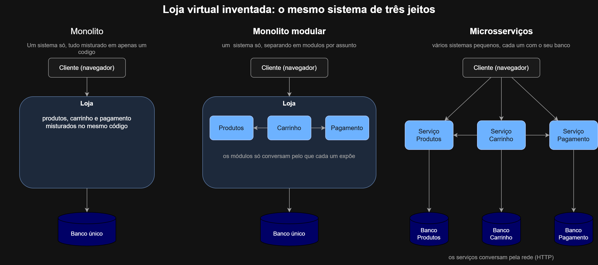

# 08 - Arquitetura de software

Neste estudo eu aprendi os três jeitos de organizar um sistema: monolito, monolito modular e microsserviços. E no Busca CEP eu separei o back-end em módulos (cep, historico e cache).

## Os três jeitos

| | Monolito | Monolito modular | Microsserviços |
|---|---|---|---|
| **Vantagens** | É fácil e rápido de começar, pois é tudo em um só lugar | resolve a bagunça do monolito: cada assunto fica em uma pasta específica, e um módulo só usa o que o outro mostra. Continua sendo um sistema só, bem simples de rodar | empresa grande usa, pois cada equipe pode cuidar do seu serviço sem atrapalhar as outras, e se um serviço cai, os outros continuam no ar |
| **Desvantagens** | conforme cresce, vai virando bagunça, e mexer numa parte pode quebrar a outra | continua sendo um sistema só: se cair, cai tudo junto, e o banco é um só | em um projeto pequeno seria muito exagero, pois seriam vários sistemas e vários bancos para cuidar, e a comunicação pela rede dá muito trabalho para pouco ganho |
| **Quando usar** | projeto pequeno ou duas pessoas | projeto pequeno ou duas pessoas (recomendo o modular) | empresa com dez equipes |

## A loja inventada nos três jeitos



No monolito os produtos, carrinho e pagamento ficam juntos, com um banco só. No modular, eles ficam separados em módulos, mas dentro do mesmo sistema e com um banco só. Nos microsserviços, cada um é um sistema separado, com o seu próprio banco, somando três bancos.

## Busca CEP: antes e depois

### Antes (tudo no server.js)

```
backend/
├── package.json
├── prisma/
│   └── schema.prisma
└── src/
    └── server.js
```

### Depois (separado em módulos)

```
backend/
├── package.json
├── prisma/
│   └── schema.prisma
└── src/
    ├── server.js
    └── modulos/
        ├── cep/
        │   ├── index.js
        │   ├── cep.rotas.js
        │   └── cep.servico.js
        ├── historico/
        │   ├── index.js
        │   ├── historico.rotas.js
        │   ├── historico.servico.js
        │   └── prisma.js
        └── cache/
            ├── index.js
            └── cache.servico.js
```

### Por que ele é um monolito modular

O Busca CEP é um monolito modular porque é um sistema só, com um banco só, e as pastas são separadas por assunto (cep, historico e cache). Cada pasta compartilha apenas o que expõe no seu index.js, e uma pasta nunca entra nos arquivos de dentro da outra.
