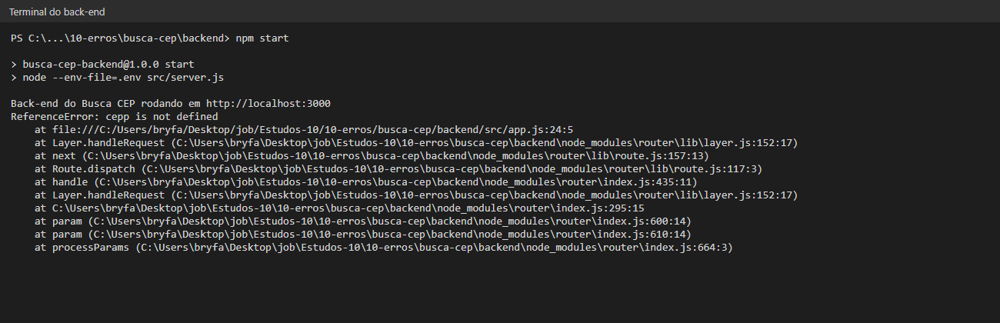
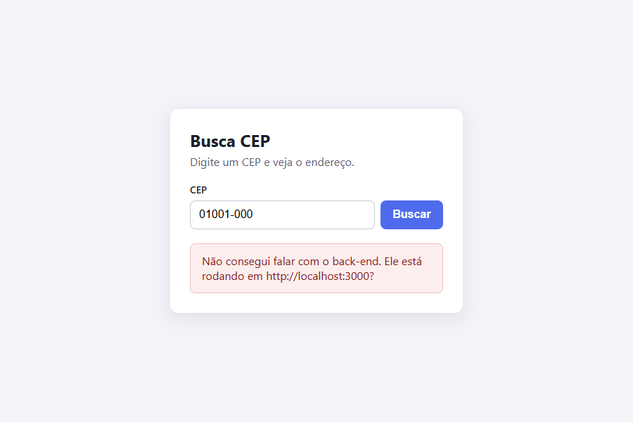
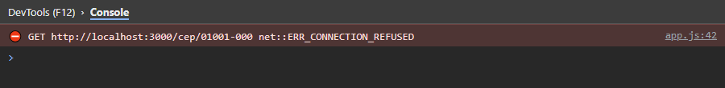
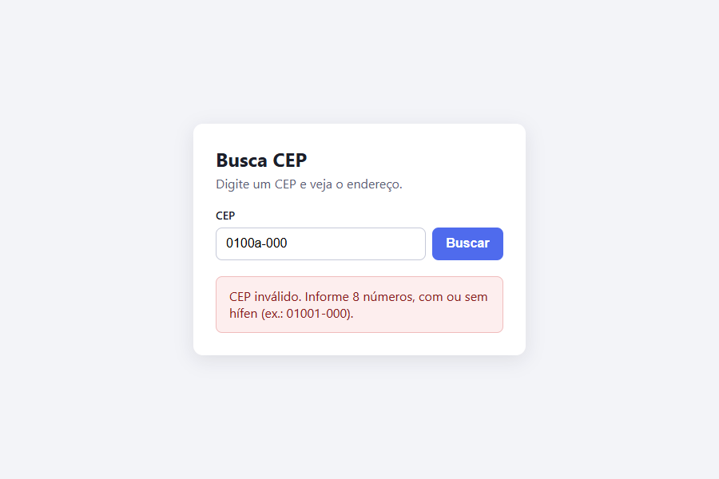
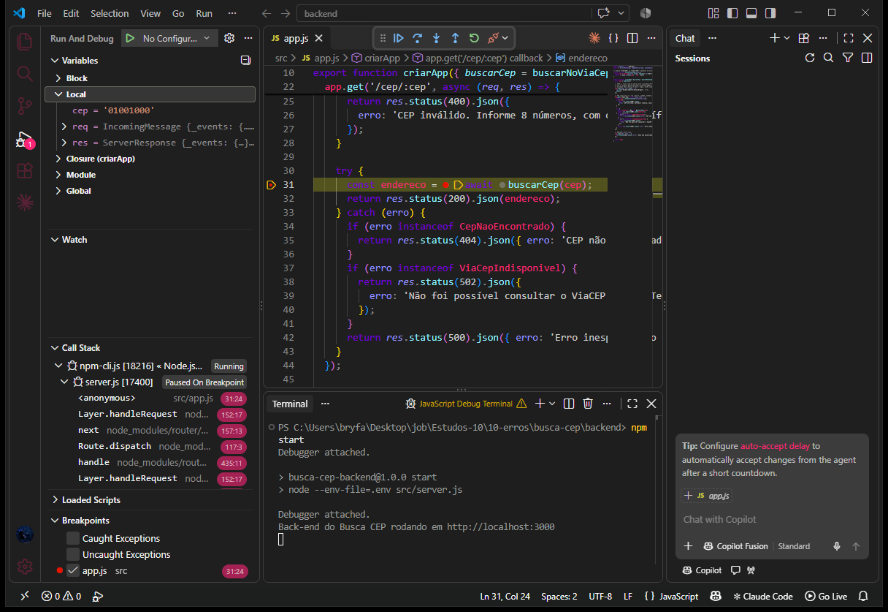
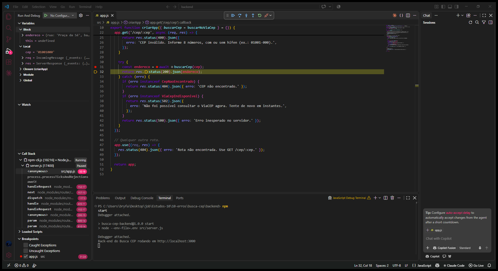

# 10 - Erros e depuração

Neste estudo eu provoquei três erros no Busca CEP, li a mensagem de cada um antes de pedir ajuda e usei um breakpoint no VS Code para ver o valor das variáveis no meio da busca.

## Os três erros

### Erro 1: nome de variável errado no back-end

- **Onde apareceu:** no terminal do back-end
- **O que diz:** `ReferenceError: cepp is not defined`, ou seja, a variável `cepp` não está definida (a página recebeu erro 500)
- **Arquivo e linha:** `backend/src/app.js`, linha 24
- **Correção:** trocar `cepp` por `cep`

### Erro 2: front-end chamando com o back-end desligado

- **Onde apareceu:** no navegador, na página e no console
- **O que diz:** `net::ERR_CONNECTION_REFUSED`, ou seja, conexão recusada, porque ninguém estava atendendo na porta 3000
- **Arquivo e linha:** `frontend/app.js`, linha 42 (o `fetch` que chama o back-end)
- **Correção:** ligar o back-end; o código não estava errado

### Erro 3: CEP com letras

- **Onde apareceu:** na página e na aba Rede
- **O que diz:** `400 Bad Request` e "CEP inválido. Informe 8 números", ou seja, o pedido estava errado
- **Arquivo e linha:** quem percebeu foi o back-end, em `backend/src/app.js`, linha 24
- **Correção:** digitar só números

## Depurador no VS Code

Coloquei um breakpoint na rota `/cep` do back-end (`app.js`, linha 31) e rodei o back-end no JavaScript Debug Terminal. Na hora da busca, o programa parou na linha 31 e deu para ver que o `cep` já estava sem o hífen (`'01001000'`).

Depois apertei F10 para ir para a próxima linha, e apareceu o `endereco` com a rua, o bairro, a cidade e o estado que vieram do ViaCEP.

## Como ler uma mensagem de erro (stack trace)

1. Primeiro leio a primeira linha, que diz o tipo do erro e o que aconteceu (ex.: `ReferenceError: cepp is not defined`).
2. Depois procuro, nas linhas que começam com `at`, a que é do meu código. No erro 1 foi `app.js:24:5` (linha 24, coluna 5).
3. As linhas com `node_modules` são de código que eu instalei (como o Express), então eu pulo, porque o erro costuma estar no meu código.

## Como pedir ajuda bem

Mandar "deu erro, me ajuda" não ajuda ninguém. Para a IA ou outra pessoa conseguir ajudar, eu mando:

- **a mensagem de erro inteira**, copiada, e não só um pedaço
- **o que eu fiz** antes do erro
- **o que eu esperava** que acontecesse

Exemplo: "Rodei `npm start` e busquei o CEP 01001-000. Esperava aparecer o endereço, mas apareceu Erro 500 e no terminal: `ReferenceError: cepp is not defined at app.js:24:5`".
