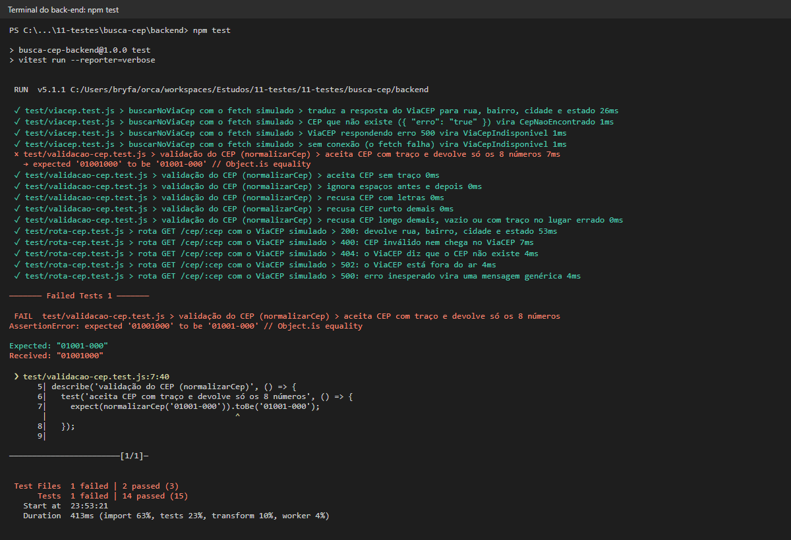

# 11 - Testes automatizados e CI

Coloquei testes no Busca CEP com o Vitest e configurei o GitHub Actions para rodar os testes em todo pull request.

## Tipos de teste

- **Unitário:** testa uma peça pequena sozinha. Aqui é a validação do CEP (`normalizarCep`).
- **Integração:** testa peças funcionando juntas. Aqui o teste sobe o back-end e chama a rota `/cep`.
- **Ponta a ponta (e2e):** testa tudo como a pessoa usaria, abrindo a página no navegador. Não fiz neste estudo.

## Mock

Mock é uma peça de mentira no lugar de uma de verdade. Nos testes, o ViaCEP é trocado por uma função falsa (`vi.fn()`), então os testes não precisam de internet e dá para simular o erro (CEP que não existe, ViaCEP fora do ar).

## Como rodar

```bash
cd 11-testes/busca-cep/backend
npm install
npm test
```

Todos passando:


Um teste quebrado de propósito (esperava o CEP com traço):



Corrigido:


## CI

CI é um robô que roda os testes sozinho toda vez que alguém abre um pull request. Aqui ele fica em `.github/workflows/testes.yml`. Se um teste falha, o PR fica vermelho; se todos passam, fica verde.

## Por que PR vermelho não entra

PR vermelho quer dizer que o código novo quebrou algo. Se entrar na `main`, o erro vai junto para todo mundo. Então eu corrijo na minha branch até ficar verde e só depois faço o merge.
