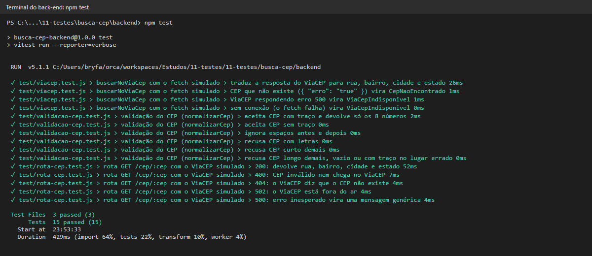

# 11 - Testes automatizados e CI

Neste estudo eu coloquei testes automatizados no Busca CEP com o Vitest e configurei o GitHub Actions para rodar esses testes em todo pull request do estudos. Assim, se alguém quebrar o código, o PR fica vermelho antes de entrar na `main`.

## O que é cada tipo de teste

- **Teste unitário:** testa uma peça pequena do código sozinha, sem servidor, sem banco e sem internet. Aqui é o teste da função `normalizarCep`, que diz se o CEP é válido.
- **Teste de integração:** testa várias peças funcionando juntas. Aqui o teste sobe o back-end de verdade (o Express) e chama a rota `/cep`, para ver se a rota, a validação e o tratamento de erro conversam direito.
- **Teste de ponta a ponta (e2e):** testa o sistema inteiro como a pessoa usaria, abrindo a página no navegador, digitando o CEP e vendo o endereço aparecer. É o mais completo, mas também o mais lento. Neste estudo eu não fiz e2e.

## O que é mock

Mock é uma peça de mentira que entra no lugar de uma de verdade durante o teste. No Busca CEP, o ViaCEP é um serviço de fora, na internet. Se o teste chamasse o ViaCEP de verdade, ele ia falhar sem internet ou quando o ViaCEP estivesse fora do ar, mesmo com o meu código certo.

Por isso, nos testes eu troquei o ViaCEP por uma função falsa (`vi.fn()`), e cada teste diz o que ela devolve: um endereço, "CEP não encontrado" ou "fora do ar". Assim dá para testar até o caso de erro, que no ViaCEP de verdade eu não consigo provocar quando quero.

## Os testes do Busca CEP

Ficam em `busca-cep/backend/test`:

| Arquivo | Tipo | O que testa |
|---|---|---|
| `validacao-cep.test.js` | unitário | CEP com traço, sem traço, com letras, curto demais e longo demais |
| `rota-cep.test.js` | integração | rota `/cep` com o ViaCEP simulado: 200 (endereço), 400 (CEP inválido), 404 (não existe), 502 (ViaCEP fora do ar) e 500 (erro inesperado) |
| `viacep.test.js` | unitário | a função que fala com o ViaCEP, com o `fetch` simulado: resposta certa, CEP que não existe, erro 500 e sem conexão |

### Como rodar

```bash
cd 11-testes/busca-cep/backend
npm install
npm test
```

Não precisa de internet nem do arquivo `.env`, porque o ViaCEP é simulado.

### Todos passando


### Um teste quebrado de propósito

Troquei o resultado esperado do teste "aceita CEP com traço" para `'01001-000'` (com traço). Como a função devolve o CEP sem traço, o Vitest mostrou o teste com um `×`, o valor esperado (`Expected`), o valor que veio (`Received`) e a linha do teste que falhou.


### Corrigido

Voltei o valor esperado para `'01001000'` e os 15 testes passaram de novo.



## O que é CI

CI (integração contínua) é um robô que roda os testes sozinho toda vez que alguém manda código. No estudos, o CI fica no GitHub Actions, no arquivo `.github/workflows/testes.yml`. Em todo pull request, ele baixa o código, instala as dependências com `npm ci` e roda o `npm test`.

- Se todos os testes passam, o check fica **verde** ✅.
- Se algum teste falha, o check fica **vermelho** ❌ e mostra qual teste quebrou.

## Por que um PR vermelho não entra

O PR vermelho quer dizer que o código novo quebrou alguma coisa que funcionava antes. Se ele entrar na `main`, o erro vai junto, e todo mundo que começar uma tarefa a partir da `main` já começa com o código quebrado. Por isso, o certo é corrigir na própria branch até o CI ficar verde e só depois fazer o merge. Assim o erro é pego no PR, e não pelo usuário.
