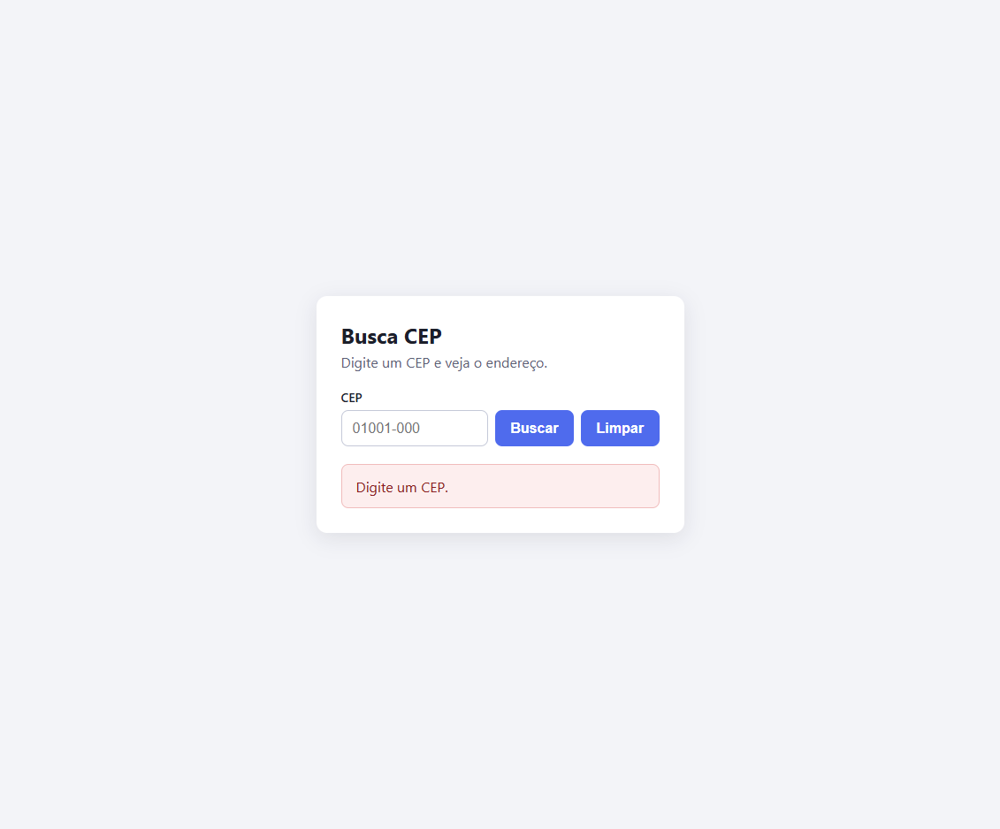
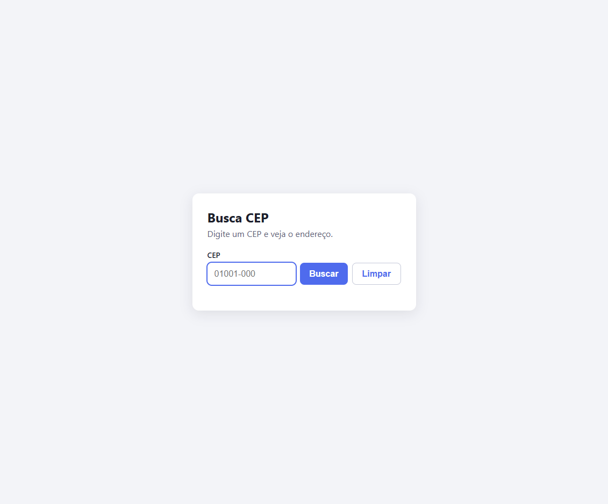

# 12 - Um bom CLAUDE.md e pedidos bem escritos para o Claude Code

Neste estudo eu fiz um `CLAUDE.md` com as regras do estudos e aprendi a escrever pedidos melhores para o Claude Code. Para ver a diferença na prática, fiz a mesma tarefa no Busca CEP com um pedido ruim e com um pedido bom.

## O que é o CLAUDE.md

É um arquivo na raiz do projeto que o Claude Code lê sozinho toda vez que começa. Nele eu coloco o que ele não descobre lendo o código: como rodar e testar o Busca CEP, em qual pasta ele está e as regras do repositório (um commit por etapa, testes antes do commit, nada de chave no código e o README é meu).

O do estudos está em [`../CLAUDE.md`](../CLAUDE.md).

## Pedido bom

Um pedido bom tem quatro partes:

- **Objetivo:** o que eu quero no final.
- **Contexto:** a pasta, os arquivos e o que já existe.
- **O que não mexer:** o que fica de fora.
- **Como saber que ficou pronto:** um teste ou um passo a passo que dá para conferir.

## Os três pedidos, antes e depois

| Antes | Depois (resumo) |
|---|---|
| "coloca um botão de limpar no busca cep" | Botão "Limpar" no front do `05-busca-cep` que apaga o CEP e o resultado e volta o cursor para o campo. Não mexer no back-end, nos testes, no 06, no 07 nem no README. Pronto quando: busco um CEP, clico em Limpar e fica tudo vazio, e o `npm test` continua passando. |
| "a busca tá lenta, arruma" | Descobrir por que a busca demora e me dizer a causa antes de mudar algo. Não colocar cache nem dependência nova, nem mudar o código ainda. Pronto quando: ele me mostra quanto tempo cada parte leva e onde está a demora. |
| "escreve o readme do estudo 12 explicando o claude.md" | Me ajudar a escrever o README sem escrever por mim. Não criar nem mudar o `README.md`. Pronto quando: tem um arquivo de notas com o que foi feito e as dúvidas que o README precisa responder. |

Os pedidos completos estão em [pedidos.md](pedidos.md).

## O antes e depois no Busca CEP

A tarefa foi colocar um botão de limpar no Busca CEP. Saíram duas branches da `develop`:

- `feat/12-antes-pedido-ruim`: feita só com o pedido "coloca um botão de limpar no busca cep".
- `feat/12-depois-pedido-bom`: feita com o `CLAUDE.md` e o pedido bom.

As duas versões foram escritas para a comparação, uma seguindo só o pedido ruim e a outra seguindo o pedido bom. Depois testei as duas na página e com o `npm test`.

| | Antes | Depois |
|---|---|---|
| Limpa o campo | sim | sim |
| Limpa o resultado | não | sim |
| Cursor volta para o campo | não | sim |
| Dispara a busca sem querer | **sim** | não |
| `npm test` | 8 de 8 passando | 8 de 8 passando |

O erro do antes: o botão ficou sem `type="button"`. Dentro de um formulário, botão sem tipo envia o formulário, então clicar em Limpar também fazia a busca com o campo vazio e aparecia "Digite um CEP.".

No depois, o campo e o resultado ficam vazios:

O `npm test` passou nas duas, porque os testes são só do back-end. Por isso o pedido bom precisa dizer como conferir na página, e não só "rode os testes".

O diff, o teste passo a passo e todos os prints estão em [comparacao.md](comparacao.md).

## 5 dicas que vou usar no trabalho

1. **Colocar no CLAUDE.md só o que ele não vê lendo o código:** o comando de teste, as regras e as decisões que não estão escritas. Curto funciona melhor.
2. **Pedido específico:** dizer o arquivo, o problema e como é "pronto".
3. **Dar um jeito de ele conferir o trabalho:** um teste ou um passo a passo, e pedir a prova (a saída do teste), não só "passou".
4. **Regra que não pode ter exceção não fica só no CLAUDE.md:** vai para o `.gitignore`, as permissões ou um hook, que o Claude Code obriga de verdade.
5. **Acompanhar e corrigir cedo:** apertar `Esc` se ele for para o lado errado e, depois de duas correções que não deram certo, usar `/clear` e escrever um pedido melhor.

Vídeo: [A Própria Anthropic Explica Como Usar o Claude Code](https://youtu.be/iMso7WbhUr0). As dicas foram tiradas da [página de boas práticas do Claude Code](https://code.claude.com/docs/en/best-practices), que o vídeo indica.

> conferir com o vídeo
