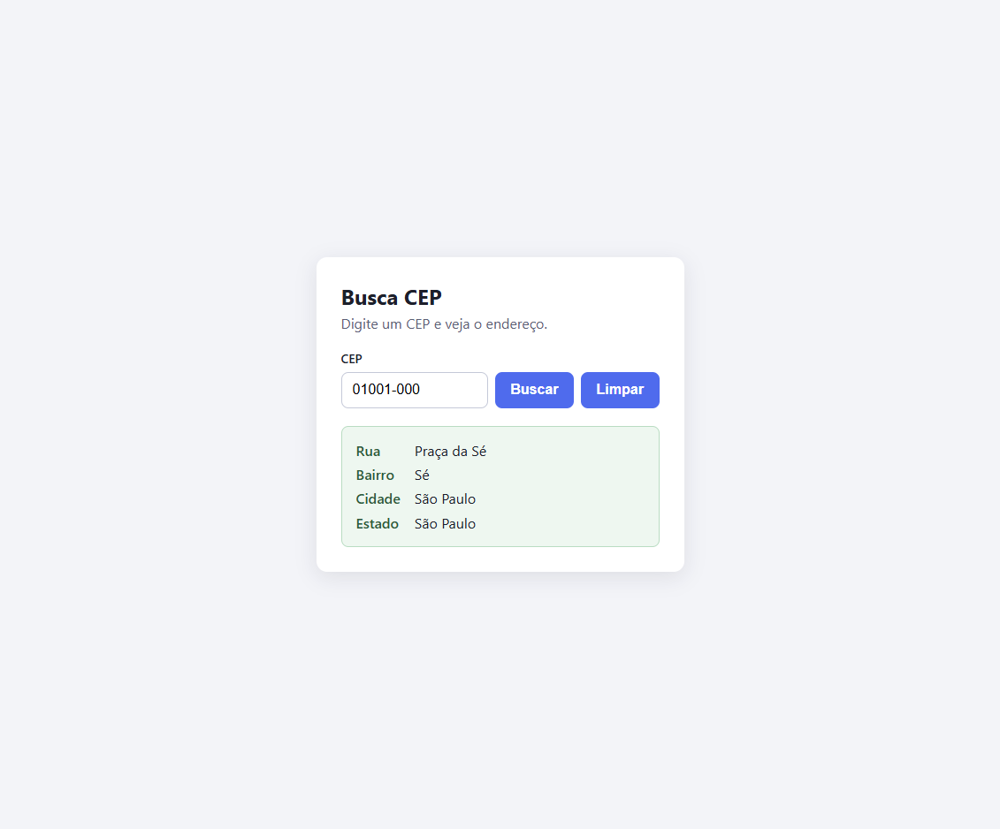
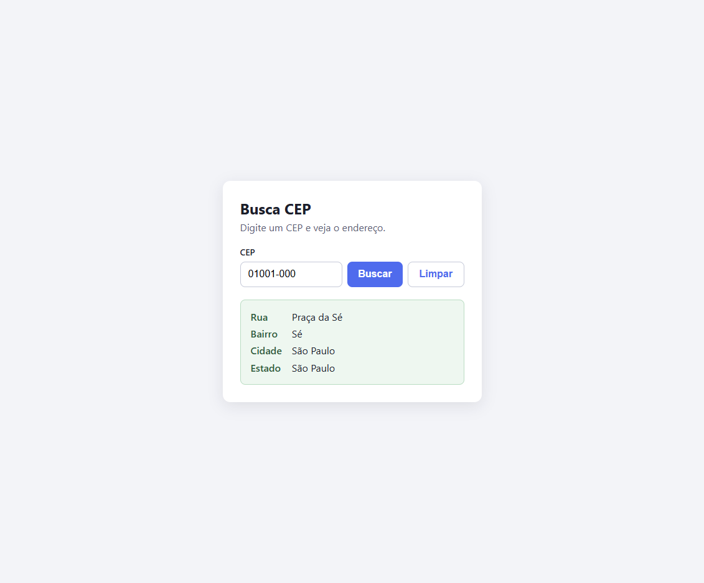
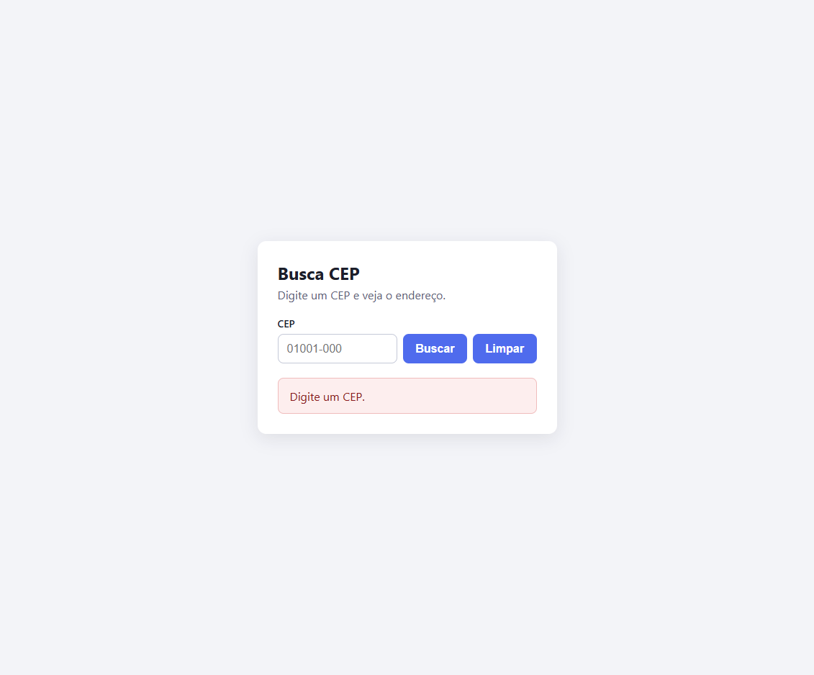
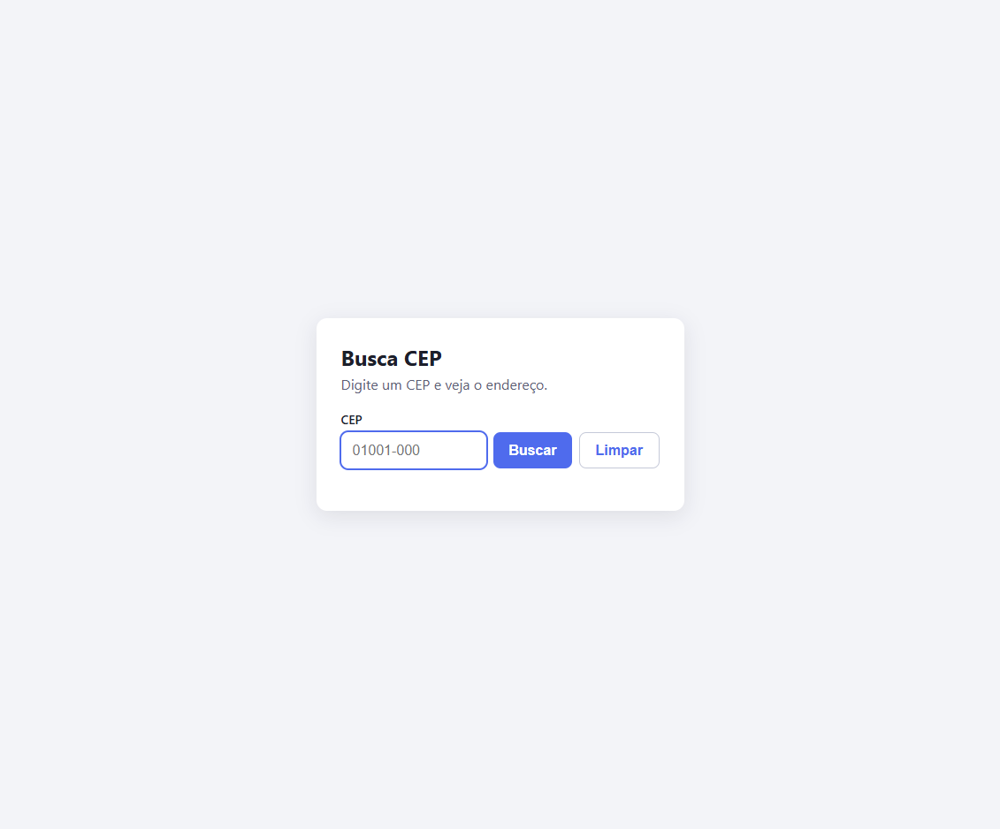
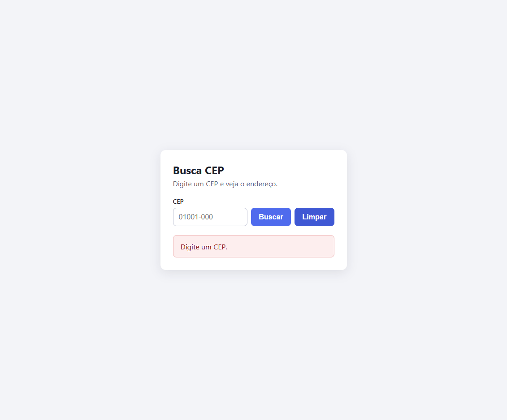

# Notas: antes e depois do botão Limpar

Material de apoio para escrever o README da 12. **Não é o README.**

> **Como a comparação foi feita:** as duas versões foram escritas de propósito para a comparação,
> uma seguindo só o pedido ruim e a outra seguindo o CLAUDE.md e o pedido bom. Por isso a versão
> ruim mostra os erros que um pedido vago deixa acontecer. O teste na página e o `npm test`
> foram rodados de verdade nas duas.

## A tarefa

Colocar um botão de limpar a busca no Busca CEP (`05-busca-cep`).

As duas branches saíram da develop atualizada (`8f598b2`, PR #16):

| | Branch | Commit |
|---|---|---|
| Antes (pedido ruim) | `feat/12-antes-pedido-ruim` | `879cf79 botão limpar` |
| Depois (CLAUDE.md + pedido bom) | `feat/12-depois-pedido-bom` | `b95dec5 feat: botão Limpar no Busca CEP que apaga o CEP e o resultado e volta o cursor para o campo` |

Para ver o diff de cada uma:

```bash
git diff develop feat/12-antes-pedido-ruim
git diff develop feat/12-depois-pedido-bom
```

## Os dois pedidos

**Ruim** (sem CLAUDE.md, porque a develop ainda não tinha um):

> coloca um botão de limpar no busca cep

**Bom** (com o `CLAUDE.md` da raiz): o pedido 1 do [pedidos.md](pedidos.md): objetivo (limpar
o CEP e o resultado e voltar o cursor para o campo), contexto (`05-busca-cep`, front em HTML,
CSS e JS puros), o que não mexer (back-end, testes, cópias do 06 e do 07, README) e como saber
que ficou pronto (o passo a passo na página, `npm test` passando, um commit só).

## O diff

### Antes: 2 arquivos, 5 linhas

```diff
 <button id="botao" type="submit">Buscar</button>
+<button id="limpar">Limpar</button>
```

```diff
+document.getElementById('limpar').addEventListener('click', () => {
+  campoCep.value = '';
+});
```

### Depois: 3 arquivos, 14 linhas

```diff
 <button id="botao" type="submit">Buscar</button>
+<!-- type="button": dentro do form, sem isso o botão também enviaria a busca. -->
+<button id="limpar" type="button" class="secundario">Limpar</button>
```

```diff
+const botaoLimpar = document.getElementById('limpar');
 ...
+// Limpar: apaga o CEP digitado e o resultado (endereço ou erro) e volta o cursor para o campo.
+botaoLimpar.addEventListener('click', () => {
+  campoCep.value = '';
+  resultado.replaceChildren();
+  campoCep.focus();
+});
```

```diff
+/* Botão Limpar: menos destaque que o Buscar. */
+button.secundario { color: #4f6bed; background: #fff; border: 1px solid #c5c9d8; }
+button.secundario:hover { background: #eef1fd; }
```

## O teste na página

O mesmo roteiro nas duas branches, no navegador: buscar `01001-000`, clicar em Limpar, buscar
`123` (CEP inválido) e clicar em Limpar de novo. Depois de cada passo foi lido o que estava no
campo, o que estava no resultado e se o cursor estava no campo.

| Passo | Antes (pedido ruim) | Depois (pedido bom) |
|---|---|---|
| 1. buscar `01001-000` | endereço da Praça da Sé | endereço da Praça da Sé |
| 2. clicar em Limpar | campo vazio, **mas aparece o erro "Digite um CEP."**, cursor fora do campo | campo e resultado vazios, cursor no campo |
| 3. buscar `123` | erro "CEP inválido..." | erro "CEP inválido..." |
| 4. clicar em Limpar | campo vazio, **"Digite um CEP." no lugar do erro**, cursor fora do campo | campo e resultado vazios, cursor no campo |

Prints:

| | Antes | Depois |
|---|---|---|
| Depois de buscar |  |  |
| Depois de Limpar |  |  |
| Limpar depois do erro |  |  |

## `npm test`

Nas duas branches: `cd 05-busca-cep/backend && npm test` → **8 testes, 8 passando, 0 falhando**.

Isso mostra uma coisa importante: os testes são só do back-end, então a versão ruim passa
neles mesmo com o botão quebrado. Por isso o pedido bom diz como conferir na página, e não só
"rode os testes".

## O que cada versão fez e errou

### Antes (pedido ruim)

- **Erro de verdade:** o botão ficou sem `type="button"`. Dentro de um `<form>`, botão sem tipo
  é de envio, então clicar em Limpar também dispara a busca com o campo vazio e aparece
  "Digite um CEP.". O botão "limpa" e logo em seguida mostra um erro.
- Só apaga o campo; o endereço (ou o erro) que estava na tela não é apagado pelo botão.
- O cursor não volta para o campo.
- Os dois botões ficaram iguais (azuis), então Limpar tem o mesmo destaque que Buscar.
- Mensagem de commit vaga (`botão limpar`), sem o padrão `tipo: o que foi feito`.
- Nada foi conferido na página antes do commit; o pedido não dizia como saber que ficou pronto.

O que o pedido ruim deixou em aberto e virou chute: limpar o quê (campo, resultado ou os dois),
em qual das três cópias do Busca CEP (05, 06 ou 07), se o botão devia ter outro estilo e como
conferir.

### Depois (CLAUDE.md + pedido bom)

- Botão com `type="button"`, então não envia o formulário.
- Apaga o campo e o resultado e devolve o cursor para o campo, como o pedido dizia.
- Botão com estilo secundário (branco com borda), para o Buscar continuar sendo o principal.
- Mexeu só nos três arquivos do front-end do `05-busca-cep`; back-end, testes, 06, 07 e README
  ficaram de fora, como o pedido mandava.
- `npm test` rodado antes do commit (regra do CLAUDE.md) e o roteiro conferido na página
  (o "como saber que ficou pronto" do pedido).
- Um commit só, com a mensagem no padrão do CLAUDE.md.

## Resumo para usar no README

| | Antes | Depois |
|---|---|---|
| Arquivos | 2 | 3 |
| Linhas | 5 | 14 |
| Limpa o campo | sim | sim |
| Limpa o resultado | não (mostra um erro novo) | sim |
| Cursor volta para o campo | não | sim |
| Dispara a busca sem querer | **sim** | não |
| `npm test` | 8/8 (não pega o erro) | 8/8 |
| Conferido na página antes do commit | não | sim |
